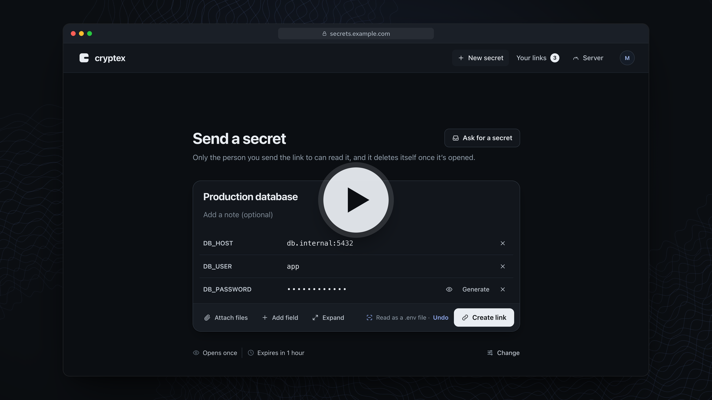

<div align="center">

<picture>
  <source media="(prefers-color-scheme: dark)" srcset="docs/assets/icon-dark.svg">
  
</picture>

<h1>Cryptex</h1>

<p><strong>Share passwords, keys and files through links that are encrypted in your browser.</strong></p>

<p>
  <a href="https://github.com/polius/Cryptex/actions/workflows/ci.yml"></a>
  <a href="https://github.com/polius/Cryptex/releases"></a>
  <a href="https://hub.docker.com/r/poliuscorp/cryptex"></a>
  <a href="LICENSE"></a>
</p>

<br>

<a href="https://pol.alzina.dev/videos/cryptex.mp4"></a>

<p><em>About a minute: sealing a secret into a link, why your server can’t read it, and what else Cryptex does.<br>Plays as an MP4 in your browser.</em></p>

</div>

## Features

The server stores only ciphertext: it can't read the secret, its title or its file names. If you send while signed in, it knows which account sent it.

- **Encrypted before it leaves your browser.** The key is part of the link, so only the people you give the link to can open it.
- **Links that expire.** Choose how long a link lasts, or make it work only once.
- **Optional passphrase.** Protect a link with a passphrase and share it separately.
- **Text and files.** Share passwords, notes, keys or whole files. Logins and keys are laid out clearly for the recipient.
- **Know when it's opened.** See when each link was opened, and destroy it at any time.
- **Ask for a secret.** Send someone a link to put a secret in, no account needed. Only you can open what they send.
- **Built for teams.** Invite your colleagues, set limits, add your logo and review an activity log that never contains secrets.

## Quick start

### Option A: on your computer (HTTP)

To try Cryptex. Browsers only allow its encryption on `https://` pages and on `localhost`, so this works on this computer only.

With Docker:

```sh
docker run -d --name cryptex --restart unless-stopped -p 127.0.0.1:8080:8080 \
  -v "$PWD/data:/data" poliuscorp/cryptex:3
```

Or with Docker Compose:

```sh
curl -fsSLO https://raw.githubusercontent.com/polius/Cryptex/main/deploy/docker-compose.yml
docker compose up -d
```

Open `http://localhost:8080`. The first screen asks for a setup code: `docker exec cryptex cryptex setup-code` prints it (it's also in `docker logs cryptex`).

### Option B: on your own domain (HTTPS, recommended)

You need a server with a public IP address and a domain name. [Caddy](https://caddyserver.com) runs alongside Cryptex and gets the certificate for you.

1. Point your domain's DNS (an `A` record) at the server, and open the [required ports](#required-ports).
2. Download the two files:

   ```sh
   curl -fsSL https://raw.githubusercontent.com/polius/Cryptex/main/deploy/docker-compose-ssl.yml -o docker-compose.yml
   curl -fsSLO https://raw.githubusercontent.com/polius/Cryptex/main/deploy/Caddyfile
   ```

3. Open `Caddyfile` and replace `yourdomain.com` on the first line with your domain.
4. Start it:

   ```sh
   docker compose up -d
   ```

Open `https://yourdomain.com` and enter the setup code from `docker exec cryptex cryptex setup-code`.

Behind another proxy (nginx, Traefik, a Cloudflare Tunnel, Tailscale), see [docs/deploy.md](docs/deploy.md).

### Updating

The image tag `:3` follows every 3.x release and never jumps to a new major version. [Back up](#backup-and-restore) first, and read the [release notes](https://github.com/polius/Cryptex/releases) before moving to a new major version.

With Docker:

```sh
docker pull poliuscorp/cryptex:3
docker stop cryptex && docker rm cryptex
docker run -d --name cryptex --restart unless-stopped -p 127.0.0.1:8080:8080 \
  -v "$PWD/data:/data" poliuscorp/cryptex:3
```

`docker stop` lets the server finish its writes and fold its write-ahead log into the database; `docker rm -f` doesn't.

Or with Docker Compose:

```sh
docker compose pull && docker compose up -d
```

## Backup and restore

Everything lives in the data folder (`./data`): the database, the encrypted chunks, the logo, and `enc.key`, the key that protects sign-in data. **Without `enc.key` nobody can sign in again**, so keep it in every backup.

To back up, stop the server, copy the folder, and start it again. Stopping lets the database finish its writes, so the copy is complete; don't copy the folder while the server runs.

```sh
docker stop cryptex
sudo cp -a data backup-$(date +%F)   # the files belong to the container's user, UID 10001
docker start cryptex
```

Keep the copy as private as the server: with an old link and a backup, a secret can be opened again.

To restore, stop the server, put the backup's contents back in the data folder, and start it:

```sh
docker stop cryptex
sudo rm -rf data/* && sudo cp -a backup-2026-11-16/. data/
docker start cryptex
```

A restore brings back the server as it was at the backup: links opened or destroyed since then work again until they expire, and links made since then are gone.

### Required ports

For Option B, open these on your server's firewall (and in your cloud provider's security group, if it has one):

| Port | Protocol | Purpose |
|---|---|---|
| `443` | TCP + UDP | The web interface over HTTPS (UDP for HTTP/3) |
| `80` | TCP | Getting the certificate, and redirecting to HTTPS |

Option A opens no ports: Cryptex listens on `127.0.0.1:8080`, this computer only.

## Configuration

Cryptex needs no configuration. To change a default, pass the variable to `docker run` with `-e`, such as `-e MAX_FILES=10`, or add it under `environment:` on the `cryptex` service in the compose file. An invalid value stops the server at start and names the variable.

Formats: sizes `500kb`, `10mb`, `1gb` · durations `30m`, `24h`, `7d` · rates `60/h`, `10/15m`.

### Server

| Variable | Default | Description |
|---|---|---|
| `TRUSTED_PROXIES` | `127.0.0.1,::1` | Proxy addresses or CIDRs, comma-separated, allowed to report the visitor's address. Name exactly your proxy: anyone listed can claim any address. The HTTPS compose file sets it to its Caddy. |
| `MIN_FREE_DISK` | `1gb` | New links are refused when they'd leave less free disk space than this. |

### Links and access

These can also be changed in the **Server** tab. Setting the variable locks them there.

| Variable | Default | Description |
|---|---|---|
| `ACCESS` | `anyone` | Who can create links and ask for secrets: `anyone` or `signed_in`. Opening a link, or answering a request, never needs an account. |
| `MAX_EXPIRATION` | `7d` | Longest lifetime offered for a link, at least `5m`. |
| `MAX_MESSAGE_LENGTH` | `10000` | Characters per link, across all notes and fields. |
| `MAX_FILES` | `5` | Files per link (`0` turns files off). |
| `MAX_FILE_SIZE` | `100mb` | Size per file. |
| `BRAND_NAME` | none | Organization name shown to recipients. |
| `AUDIT_RETENTION_DAYS` | `365` | Audit events older than this are deleted. |

### Rate limits

Counted per visitor address, or per account for someone signed in (so colleagues behind one office address don't share them).

| Variable | Default | Limits |
|---|---|---|
| `RATE_CREATE` | `60/h` | Links created (per account when signed in). |
| `RATE_REVEAL` | `120/h` | Links opened. |
| `RATE_STATUS` | `600/h` | Status checks from *Your links*. |
| `RATE_AUTH` | `10/15m` | Wrong passwords, 2FA, reset and setup codes. Each account also allows 30 an hour in total. |

### Logs and metrics

| Variable | Default | Description |
|---|---|---|
| `LOG_LEVEL` | `info` | Even `debug` never logs tokens or contents. |
| `LOG_FORMAT` | `json` | `json` or `text`. |
| `LOG_IPS` | `false` | Add the visitor's address to request logs. |
| `METRICS_TOKEN` | none | Enables Prometheus metrics at `/api/v1/metrics` for `Authorization: Bearer <token>`. |

### Public demo

`DEMO=true` turns the server into a public demo: links last at most 1 hour and hold 500 characters and one 1 MB file, there's no sign-in, a proof of work and a daily quota per address, search engines are kept out, and everything is wiped every day at 00:00 UTC. Run it on its own domain, never on one used for real secrets.

| Variable | Default | Description |
|---|---|---|
| `DEMO_SEALS_PER_DAY` | `10` | Links per address per day. |
| `DEMO_UPLOAD_BYTES_PER_DAY` | `10mb` | Uploads per address per day. |
| `DEMO_STORAGE_CAP` | `1gb` | Total storage. |

These can only lower the defaults: a larger value is ignored, with a warning in the log.

## Security

- Secrets are encrypted in the browser with AES-GCM under keys derived from a 128-bit link key. Passphrases go through Argon2id. The format is in [docs/crypto.md](docs/crypto.md), with test vectors.
- Opening a link page changes nothing: revealing takes a click, so link previews and scanners can't use up a secret.
- Passwords never reach the server. Owners can't read, open or destroy other people's links.
- A strict Content Security Policy, no third-party requests, and no tokens or contents in logs (and no IP addresses unless `LOG_IPS` is on).

What Cryptex does and doesn't protect against is in [docs/threat-model.md](docs/threat-model.md). To report a vulnerability, or to check that a server runs the files a release built, see [SECURITY.md](SECURITY.md). A web page is only as trustworthy as the server that serves it: if you need protection from the people running the server, run your own.

## License

MIT
